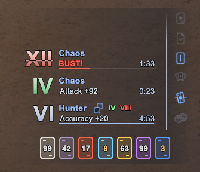

# HighRoller

**A Corsair HUD for HorizonXI (Ashita v4.30+): your Phantom Rolls at a glance, your ability
recasts, and your Quick Draw cards.**

Each roll shows its total, what it gives you at that total, and how long it has left. Lucky,
unlucky and bust totals stand out at a glance, and while Double-Up is open the roll shows the
numbers to aim for.

---

## Features

- **Roll list.** One row per roll on you, in the order they landed, with its total as a large
  numeral and its bonus at that total
- **Lucky, unlucky and bust.** Lucky totals turn green, unlucky red, and a bust is struck
  through with **BUST!** in place of the bonus
- **Double-Up help.** While Double-Up is open on your latest roll, the row shows a tag and that
  roll's lucky and unlucky numbers
- **Horizon values.** Bonuses follow the Horizon roll tables and scale with the caster's
  Corsair level, main or support job
- **Recasts.** Icons for Phantom Roll, Double-Up, Quick Draw, Random Deal, Snake Eye, Fold and
  Wild Card that light up when ready. Abilities you don't have at your job, level and merits
  never appear
- **Quick Draw cards.** A count for each element's card in your inventory, amber when running
  low and red when out
- **Reference key.** A window listing every roll and card effect, the lucky and unlucky
  numbers, and bust penalties
- **Fits your screen.** Scales with your resolution, and every part can be moved, restyled or
  turned off

## Installation

1. Extract the `HighRoller` folder into `Ashita4/addons/`
2. `/addon load highroller`

The HUD shows while Corsair is your main or support job. `/hr` opens the settings window,
which shows sample rolls so you can position and style everything without rolling.

## Reading the HUD

### Rolls

- **Numeral.** The roll's total, Roman or Arabic. Green is lucky, red is unlucky, and a struck-
  through numeral is a bust
- **Name and effect.** The roll's name in its own colour, and the bonus at the current total.
  A bust shows **BUST!** instead
- **Timer.** Time left, with an underline that drains with it. When the roll is about to wear
  off, the numeral and name blink and the timer turns red
- **Double-Up.** The dice tag beside the name marks the roll you can Double-Up, followed by its
  lucky and unlucky numbers. The tag pulses when the Double-Up window is about to close
- **Other Corsairs.** With **Other Corsairs** on, rolls from other Corsairs are listed too,
  smaller and faded, with the caster's name. For a Corsair outside your party or alliance,
  bonuses are shown at level 75

### Recasts

A thin separator runs beside the rolls, or under them, with the ability icons past it. Ready
abilities light up in the ready colour; recharging ones are dimmed or hidden, and can show a
timer. Hover an icon for the ability's name.

### Cards

One card per element, counting the cards in your main inventory, the only bag Quick Draw takes
them from. Hover a card for its Quick Draw effect. The cards show while you have Quick Draw.

## Settings

`/hr` opens the settings window.

**General**
- **Lock position**, **Align bottom** (rolls stack upward from the anchor) and **Custom scale**
- **Numerals** (Roman or Arabic), **Expiring at** (when rolls start to blink), **Roll colours**
  (each roll its own colour, or one colour for all) and **Background** opacity
- **Other Corsairs** (off by default) and **Reference key**

**Recasts**
- **Detach** gives the recasts their own position, as a column or a row
- **Placement** puts them beside or below the rolls
- **Cooling** dims recharging abilities or hides them until ready
- **Timers**, **Ready colour**, **Names on hover**, and a checkbox per ability

**Cards**
- **Attach to rolls** turns the cards into a row under the roll list that moves with it
- On their own, the cards have an **Orientation** and a **Frame** (left, right or none)
- **Hide empty** drops cards you have none of; off, they stay in place faded so the order
  never shifts

**Style**
- **Fonts** for the numerals and labels: any installed Windows font, by family name, with an
  offset to line up each font's baseline
- **Numeral gradient**: the colours each numeral fades between, for normal, lucky, unlucky and
  bust totals

## Moving things

Drag the roll list, the detached recasts or the cards to move them. **Lock position** stops them
all from moving, and each has a **Reset position** button on its tab.

## Commands

| Command | Effect |
|---------|--------|
| `/hr` or `/highroller` | Toggle the settings window |
| `/hr key` | Toggle the reference key |
| `/hr log` | Print the last roll packet seen |
| `/hr help` | List commands in chat |

## License

**MIT**, see [LICENSE](LICENSE). © 2026 Zaldas.

Bundled libraries keep their own notices:

| Path | License | Copyright |
|---|---|---|
| [`libs/spui/`](libs/spui/LICENSE) | BSD 3-Clause | © 2023 Tylas ([XivParty](https://github.com/Tylas11/XivParty)) |
| [`libs/gdifonts/`](libs/gdifonts/LICENSE) | MIT | © 2023 Thorny |

## Acknowledgements

- **[Tylas](https://github.com/Tylas11)**, whose XivParty sprite work the HUD's renderer builds on
- **[Thorny](https://github.com/ThornyFFXI)**, for gdifonts and everything he does for Ashita
  and the wider FFXI community
- **The [HorizonXI wiki](https://horizonffxi.wiki/)** editors, for the Horizon roll tables
